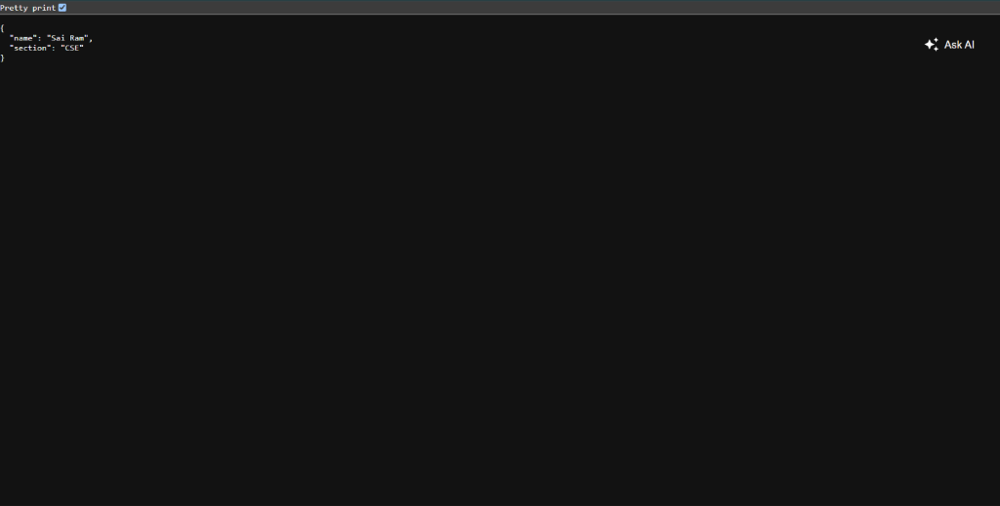

# Lab 1: Node.js and Express Server

## Student Information
- **Student Name:** PAMPANA ABHI VEERA DURGA  LAKSHMAN
- **Registration Number:** [Your Registration Number Here]
- **Section:** CSE GEN AI 2B

---

## 1. Project Description
This repository contains the complete implementation for **Lab 1 – Node.js and Express Server**. 
The objective of this lab is to:
1. Understand the fundamental concepts of Node.js and backend web servers.
2. Build a native HTTP server using Node.js's built-in `http` module (`server.js`).
3. Build a structured web application using the Express.js framework (`app.js`).
4. Implement routing (handling GET requests for root, JSON data, and dynamic datetime).
5. Implement proper HTTP 404 error handling for unmatched routes.

---

## 2. Technologies Used
- **Node.js**: JavaScript runtime environment.
- **Express.js**: Fast, unopinionated, minimalist web framework for Node.js.
- **JavaScript (ES6)**: Core programming language.
- **npm (Node Package Manager)**: Package manager for installing and managing dependencies.
- **HTTP module**: Native Node.js built-in module for server creation.

---

## 3. Project Structure
```text
lab-01/
│
├── app.js             # Express.js application with routing & 404 handler
├── server.js          # Built-in Node.js HTTP server
├── package.json       # Node.js project metadata and dependencies
├── .gitignore         # Git ignore file (excludes node_modules and .env)
├── README.md          # Project documentation and lab report
└── screenshots/       # Directory containing proof-of-work screenshots
```

---

## 4. Installation Commands

Clone the repository or navigate into the project directory:
```bash
cd lab-01
```

Install the required dependencies:
```bash
npm install
```

---

## 5. How to Run the Servers

> **Note:** Both `server.js` and `app.js` are configured to listen on **Port 3000**. Run them **one at a time** to prevent port collision (`EADDRINUSE`).

### A. Running the Built-in HTTP Server (Task 1)
In your terminal, run:
```bash
node server.js
```
Expected terminal output:
```text
Server is running at http://localhost:3000
```
To stop the server, press `Ctrl + C`.

---

### B. Running the Express.js Server (Tasks 2 – 4)
In your terminal, run:
```bash
node app.js
```
Expected terminal output:
```text
Express server is running on http://localhost:3000
```
To stop the server, press `Ctrl + C`.

---

## 6. Endpoints, HTTP Methods & Expected Responses

When running the **Express server** (`node app.js`):

| Endpoint | Method | Expected Status Code | Expected Response | Description |
| :--- | :---: | :---: | :--- | :--- |
| `http://localhost:3000/` | `GET` | `200 OK` | `Welcome to Node.js and Express Server` | Welcome text response |
| `http://localhost:3000/about` | `GET` | `200 OK` | `{"name":"PAMPANA ABHI VEERA DURGA  LAKSHMAN","section":"CSE GEN AI 2B"}` | Returns student details in JSON format |
| `http://localhost:3000/time` | `GET` | `200 OK` | Current Date & Time string (e.g., `Sun Nov 01 2026 17:25:00 GMT...`) | Returns system date and time via `new Date()` |
| `http://localhost:3000/contact` (or any unknown URL) | `GET` | `404 Not Found` | `404 - Page Not Found` | Fallback 404 error handler for unmatched routes |

---

## Screenshots

### 1. Home Page


### 2. About Page


### 3. Current Date and Time


### 4. 404 Error Page


---

## 8. Git and GitHub Submission Commands

Run the following commands in the `lab-01` directory to push your project to GitHub:

```bash
# 1. Initialize git repository (if not already initialized)
git init

# 2. Add files to staging (node_modules is ignored via .gitignore)
git add .

# 3. Check status to ensure node_modules is not staged
git status

# 4. Commit changes
git commit -m "Complete Lab 1 - Node.js and Express Server"

# 5. Set main branch
git branch -M main

# 6. Link to your GitHub repository
git remote add origin https://github.com/<your-username>/<your-repo-name>.git

# 7. Push to GitHub
git push -u origin main
```

---

## 9. Problems Faced and Solutions

- **Problem 1: Port 3000 Conflict (`EADDRINUSE`)**
  - *Cause:* Attempting to run `server.js` and `app.js` at the same time on the same port (3000).
  - *Solution:* Terminated the previous process using `Ctrl + C` before running the other server.

- **Problem 2: 404 Handler Catching Valid Routes**
  - *Cause:* In Express, middleware executes in the order it is defined. If `app.use()` 404 handler is placed above routes, valid routes will be intercepted as 404.
  - *Solution:* Placed the 404 middleware at the very bottom of `app.js`, after all valid route declarations (`/`, `/about`, `/time`).

- **Problem 3: Accidentally Staging `node_modules`**
  - *Cause:* Omitting `.gitignore` stages hundreds of internal npm files.
  - *Solution:* Created `.gitignore` containing `node_modules/` and `.env` before running `git add .`.

---

## 10. Live Deployment URL
**Not Applicable** (This is a local development laboratory assignment).

